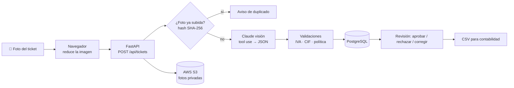

# Gestor de gastos de empleados

Los empleados hacen una foto a **uno o varios tickets**, una IA con visión (Claude) los lee,
se aplican las reglas contables y todo queda clasificado en **PostgreSQL**, listo para que
administración lo apruebe y lo exporte.

**Stack:** Python 3.12 · FastAPI · PostgreSQL (psycopg 3, SQL a mano) · Claude API (visión) · AWS S3 · Vercel



## Qué hace

- **Subida desde el móvil**: cámara o galería, varias fotos a la vez y varios tickets por foto.
- **Lectura con IA**: comercio, CIF del emisor, fecha, nº de ticket, base imponible, tipo y cuota de IVA, total, método de pago y categoría.
- **Validaciones de negocio** (`app/validacion.py`):
  - base + IVA = total (con tolerancia de redondeo); si solo viene el total, calcula la base
  - tipos de IVA españoles (0, 4, 10, 21 %)
  - NIF / NIE / CIF con **dígito de control**
  - fechas futuras o muy antiguas
  - **límites por categoría** (política de gastos, configurable en la tabla `categorias`)
  - ticket simplificado vs factura completa (deducibilidad del IVA)
  - baja confianza de la IA
- **Duplicados**: misma foto (hash) o mismo ticket (CIF + fecha + total).
- **Flujo de estados**: `revisar` → `pendiente` → `aprobado` / `rechazado`.
- **Corrección manual** que vuelve a pasar todas las validaciones.
- **Resumen** por estado y categoría, vista SQL `v_resumen_mensual` con IVA soportado.
- **Exportación CSV** para Excel (separador `;`, coma decimal, tildes correctas).
- **Modo demo**: sin clave de API funciona igual con tickets inventados.

## Arrancarlo en local

```bash
python -m venv .venv
source .venv/bin/activate          # Windows: .venv\Scripts\activate
pip install -r requirements-dev.txt

docker compose up -d               # PostgreSQL local (o usa la URL de Neon en .env)
cp .env.example .env               # y rellena lo que tengas

uvicorn app.main:app --reload
```

- Aplicación: http://localhost:8000
- Documentación interactiva de la API (Swagger): http://localhost:8000/docs
- Tests: `pytest`
- Probar solo la IA con una foto: `python -m scripts.leer_ticket ticket.jpg`

Las tablas se crean solas al arrancar (`app/schema.sql` es idempotente).

## Desplegar (Vercel + Neon + S3)

Ver [docs/DESPLIEGUE.md](docs/DESPLIEGUE.md).

## API

Todas las rutas y la web piden usuario y contraseña (HTTP Basic) si están definidos `APP_USUARIO` y `APP_CONTRASENA`. En Vercel son obligatorios: sin ellos la app responde 503.

| Método | Ruta | Qué hace |
|---|---|---|
| GET | `/api/salud` | Estado de BD, IA y almacenamiento |
| GET / POST | `/api/empleados` | Listar / crear empleados |
| GET | `/api/categorias` | Categorías y límites |
| POST | `/api/tickets` | Subir fotos (`multipart`: `empleado_id`, `archivos[]`) |
| GET | `/api/gastos` | Listar (filtros: `estado`, `empleado_id`, `categoria`, `desde`, `hasta`) |
| GET / PATCH / DELETE | `/api/gastos/{id}` | Ver / corregir / borrar |
| POST | `/api/gastos/{id}/aprobar` | Aprobar |
| POST | `/api/gastos/{id}/rechazar` | Rechazar (con motivo) |
| GET | `/api/resumen` | Totales por estado y categoría |
| GET | `/api/exportar.csv` | CSV (por defecto, los aprobados) |
| GET | `/api/fotos/{id}` | Foto original (URL firmada de S3) |

## Estructura

```
app/
  main.py         rutas FastAPI y flujo de subida
  auth.py         comprobación del usuario y la contraseña (HTTP Basic)
  extractor.py    llamada a Claude con visión (tool use = salida estructurada)
  validacion.py   reglas de negocio puras (sin BD ni web → fáciles de testear)
  db.py           consultas SQL con psycopg 3
  almacen.py      fotos en S3 o en carpeta local
  schema.sql      tablas, índices, vista y datos iniciales
static/index.html interfaz web (HTML + JS sin frameworks)
tests/            pytest
scripts/          utilidades de línea de comandos
```

## Decisiones técnicas

- **Tool use forzado** en vez de pedir "devuélveme JSON": el modelo está obligado a rellenar un esquema, así que la respuesta siempre es estructurada.
- **La IA propone, las reglas validan, la persona decide**: nada se aprueba automáticamente.
- **`NUMERIC(10,2)` y `Decimal`** para el dinero, nunca `float`.
- **Respuesta original de la IA en `JSONB`** (`datos_ia`) para auditoría.
- **SQL a mano con parámetros**: sin ORM, se ve exactamente lo que se ejecuta y no hay inyección SQL.
- **La foto se reduce en el navegador** (~1600 px): sube más rápido y respeta el límite de 4,5 MB de Vercel.
- **Fotos en S3 privado** con URLs firmadas que caducan.

## Próximos pasos

- Usuarios y roles (empleado / responsable / administración): hoy hay una única contraseña compartida.
- Procesado en segundo plano con una cola si se suben lotes grandes.
- Integración con el programa de contabilidad.
- Soporte de PDF y de tickets en otras monedas con conversión.
- Comparar coste y precisión con AWS Textract.
